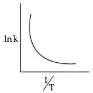
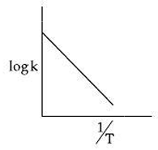
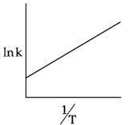

The phenomenon observed when a beam of light is passed through a colloidal solution is :
- Coagulation
- Cataphoresis
- Tyndall effect
- Electrophoresis

The following set of reactions are used in refining Zirconium. This method is called as __________

$Zr(impure) + 2I_{2} \xrightarrow{523~K} ZrI_{4}$
$ZrI_{4} \xrightarrow{1800~K} Zr(pure) + 2I_{2}$
- Zone refining
- Liquation
- Mond's process
- Van Arkel process

Match the following:
(1) Emulsion (i) Whipped Cream
(2) Gel (ii) Ink
(3) Foam (iii) Cream
(4) Sol (iv) Butter
- (1) (iv), (2) (iii), (3) (ii), (4) (i)
- (1) (iii), (2) (i), (3) (ii), (4) (iv)
- (1) (ii), (2) (i), (3) (iv), (4) - (iii)
- (1) (iii), (2) (iv), (3) (i), (4) (ii)

The pyrimidine bases present in DNA are:
- Cytosine and Thiamine
- Cytosine and Adenine
- Cytosine and Uracil
- Cytosine and Guanine

The pH of an aqueous solution is zero. The solution is:
- Neutral
- Slightly acidic
- Basic
- Strongly acidic

On reacting with neutral Ferric Chloride, Phenol gives:
- Dark green colour
- Red colour
- No colouration
- Violet colour

IUPAC name for the amine $H_{2}\dot{N}-CH_{2}-(CH_{2})_{4}-CH_{2}-\dot{N}H_{2}$
- Heptane-1, 7-diamine
- Hexamethylene diamine
- Hexane-1, 6-amine
- Hexane-1, 6-diamine

The number of electrons that have a total Charge of 9650 Coulombs is:
- $6.022\times10^{22}$
- $6.22\times10^{23}$
- $6.022\times10^{-34}$
- $6.022\times10^{24}$

Which of the following is not $sp^{2}$ hybridised ?
- Fullerene
- Graphite
- Diamond
- Graphene

$CH_{3}-CHO + CO \xrightarrow{Rh/Ir\text{ complex}} ?$
- Poly propylene
- Butan-1-al
- Acetic acid
- Acetate

The crystal with a metal deficiency defect is:
- ZnO
- NaCl
- KCI
- FeO

In the following reaction, $HC\equiv CH \xrightarrow[HgSO_{4}]{H_{2}SO_{4}} X$ Product 'X' will not give:
- Iodoform test
- Tollen's test
- Fehling solution test
- Victor Meyer test

Among the following graphs showing variation of rate constant with temperature (T) for a reaction, the one that exhibits Arrhenius behaviour over the entire temperature range is:
- 
- 
- 
- Both (b) and (c)

Which one of the following compounds is not formed ?
- $XeF_{2}$
- $XeOF_{4}$
- $NeF_{2}$
- $XeO_{3}$

In $K_{4}[Fe(CN)_{6}]$ the co-ordination number of $Fe^{2+}$ is
- 4
- 2
- 3
- 6
