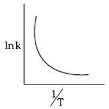
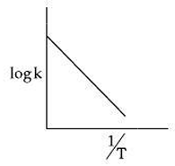
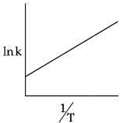

ஒரு கூழ்மக்கரைசல் வழியே ஒளிக்கற்றையை செலுத்தும் போது காணக் கிடைக்கும் நிகழ்வு:
- திரிதல்
- எதிர்மின்வாய் தொங்கலசைவு
- டின்டால் விளைவு
- மின்முனைக் கவர்ச்சி

சிர்கோனியத்தினை தூய்மையாக்கலில் பின்வரும் வினைகள் பயன்படுகின்றன. இம்முறை __________ என அழைக்கப்படுகிறது.
$Zr(impure) + 2I_{2} \xrightarrow{523~K} ZrI_{4}$
$ZrI_{4} \xrightarrow{1800~K} Zr(pure) + 2I_{2}$
- புலத்தூய்மையாக்கல்
- உருக்கிப் பிரித்தல்
- மான்ட் முறை
- வான் ஆர்கல் முறை

பொருத்துக.
(1) பால்மம் (i) கலக்கப்பட்ட கிரீம்
(2) ஜெல் (ii) இங்க்
(3) நுரை (iii) கிரீம்
(4) கூழ்ம கரைசல் (iv) வெண்ணெய்
- (1) (iv), (2) (iii), (3) (ii), (4) - (i)
- (1) (iii), (2) (i), (3) (ii), (4) - (iv)
- (1) (ii), (2) (i), (3) (iv), (4) - (iii)
- (1) (iii), (2) (iv), (3) (i), (4) (ii)

DNA -வில் காணப்படும் பிரிமிடின் காரங்கள்:
- சைட்டோசின் மற்றும் தையமின்
- சைட்டோசின் மற்றும் அடினைன்
- சைட்டோசின் மற்றும் யுராசில்
- சைட்டோசின் மற்றும் குவானைன்

ஒரு நீரிய கரைசலின் pH மதிப்பு பூஜ்ஜியம் எனில், அந்த கரைசல் :
- நடுநிலைத்தன்மை கொண்டது
- சிறிதளவு அமிலத்தன்மை கொண்டது
- காரத்தன்மை கொண்டது
- அதிக அமிலத்தன்மை கொண்டது

பீனால் நடுநிலை பெர்ரிக் குளோரைடுடன் வினைபுரிந்து தரும் நிறம் :
- அடர் பச்சை நிறம்
- சிவப்பு நிறம்
- எவ்வித நிறமும் உருவாவதில்லை
- ஊதா நிறம்

$H_{2}\dot{N}-CH_{2}-(CH_{2})_{4}-CH_{2}-\dot{N}H_{2}$ என்ற அமீனின் IUPAC பெயர் :
- ஹெப்டேன்-1, 7-டையமீன்
- ஹெக்சாமெத்திலீன் டையமீன்
- ஹெக்சேன்-1, 6-அமீன்
- ஹெக்சேன்-1, 6-டையமீன்

மொத்தமாக 9650 கூலூம்கள் மின்னூட்டத்தைப் பெற்றுள்ள எலக்ட்ரான்களின் எண்ணிக்கை :
- $6.022\times10^{22}$
- $6.22\times10^{23}$
- $6.022\times10^{-34}$
- $6.022\times10^{24}$

பின்வருவனவற்றுள் $sp^{2}$ இனக்கலப்பு இல்லாதது எது ?
- ஃபுல்லரின்
- கிராஃபைட்
- வைரம்
- கிராஃபீன்

$CH_{3}-CHO + CO \xrightarrow{Rh/Ir\text{ அணைவு}} ?$
- பாலி புரப்பிலீன்
- பியூட்டன்-1-அல்
- அசிட்டிக் அமிலம்
- அசிட்டேட்

உலோக குறையுள்ள குறைபாடு காணப்படும் படிகம் :
- ZnO
- NaCl
- KCI
- FeO

பின்வரும் வினையில், $HC\equiv CH \xrightarrow[HgSO_{4}]{H_{2}SO_{4}} X$ விளைபொருள் 'X ஆனது __________ சோதனையைத் தராது.
- அயோடோஃபார்ம் சோதனை
- டாலன்ஸ் சோதனை
- ஃபெலிங் கரைசல் சோதனை
- விக்டர் மேயர் சோதனை

ஒரு வினையின் வினைவேக மாறிலி மற்றும் வெப்பநிலைக்கு இடையேயான வரைபடம் பின்வருமாறு. இவற்றுள் வெப்பநிலை முழுமைக்கும் அர்ஹீனியஸ் தன்மையினைக் குறிப்பிடும் வரைபடம் :
- 
- 
- 
- (B) மற்றும் (C) ஆகிய இரண்டும்

பின்வரும் சேர்மங்களில் உருவாக வாய்ப்பில்லாத சேர்மம் எது ?
- $XeF_{2}$
- $XeOF_{4}$
- $NeF_{2}$
- $XeO_{3}$

$K_{4}[Fe(CN)_{6}]$ -ல் $Fe^{2+}$ -ன் அணைவு எண் :
- 4
- 2
- 3
- 6
