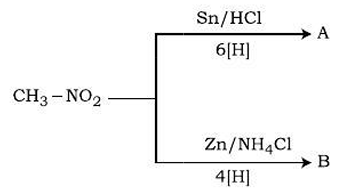

Give the uses of Borax.

Why 'd' block elements exhibit variable oxidation state ?

Define unit cell.

State Ostwald's dilution law.

Define equivalent conductance.

Mention any two factors that affect electrolytic conductance.

What is meant by Electro Osmosis ?

Write a short note on peptide bond.

From the following reaction, identify A and B.

