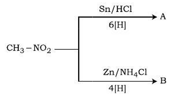

போராக்ஸின் பயன்களைத் தருக.

இடைநிலை தனிமங்கள் மாறுபடும் ஆக்சிஜனேற்ற நிலைகளைப் பெற்றுள்ளன. ஏன்?

அலகு கூட்டினை வரையறுக்கவும்.

ஆஸ்வால்ட் நீர்த்தல் விதியைக் கூறுக.

சமான கடத்துத்திறன். - வரையறுக்கவும்.

மின்பகுளிக் கடத்துத் திறனை பாதிக்கும் காரணிகளைக் குறிப்பிடுக.

மின்னாற் சவ்வூடு பரவல் என்றால் என்ன ?

பெப்டைடு பிணைப்பு பற்றி சிறு குறிப்பு வரைக.

பின்வரும் வினையில் A மற்றும் B -ஐ கண்டறிக.

