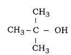
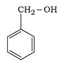

What are the differences between minerals and ores ?

Which is more stable $Fe^{3+}$ or $Fe^{2+}$ ? Why ?

Define Coordination number.

Define covalent solids.

Give examples for the first order reaction.

What are the limitations of Arrhenius concept ?

Write a note on Electrophoresis.

Give the IUPAC names :  

Identify A and B in the following sequence of reactions. $CH_{3}-Br \xrightarrow{NaN_{3}} A \xrightarrow{LiAlH_{4}} B+N_{2}$
