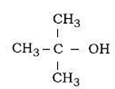
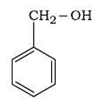

கனிமம் மற்றும் தாது ஆகியவற்றிற்கிடையேயான வேறுபாடுகள் யாவை ?

$Fe^{3+}$ மற்றும் $Fe^{2+}$ -ல் எது அதிக நிலைப்புத் தன்மை உடையது ? ஏன் ?

அணைவு எண் - வரையறுக்கவும்.

சகப்பிணைப்புப் படிகங்கள் - வரையறுக்கவும்.

முதல் வகை வினைக்கான எடுத்துக்காட்டுகளை எழுதுக.

அரீனியஸ் கொள்கையின் வரம்புகள் யாவை ?

மின்முனைக் கவர்ச்சி - குறிப்பு வரைக.

IUPAC பெயரினைக் குறிப்பிடுக.  

பின்வரும் வினைவரிசையில் உள்ள A மற்றும் B சேர்மங்களை கண்டறிக. $CH_{3}-Br \xrightarrow{NaN_{3}} A \xrightarrow{LiAlH_{4}} B+N_{2}$
