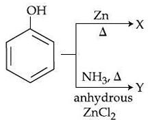

Which type of ores can be concentrated by froth floatation method? Give an example for ores.

What happens when $PCl_{5}$ is heated ?

Why do Zirconium and Hafnium exhibit similar properties ?

Define Solubility Product.

Define Equivalent Conductance.

Peptising agent is added to convert precipitate into colloidal solution. Explain this statement with an example.

Write Gattermann - Koch reaction.

How are drugs classified?

Find the products X and Y in the following reactions.

