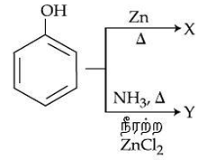

எவ்வகை தாதுக்களை அடர்ப்பிக்க நுரை மிதப்பு முறை ஏற்றது ? அத்தகைய தாதுக்களுக்கு ஓர் எடுத்துக்காட்டு தருக.

$PCl_{5}$ -ஐ வெப்பப்படுத்தும் போது நிகழ்வது யாது ?

சிர்கோனியம் மற்றும் ஹாப்னியம் ஒத்தப் பண்புகளைப் பெற்றுள்ளன. ஏன்?

கரைதிறன் பெருக்கம் - வரையறுக்கவும்.

'சமான கடத்துத்திறன்' - வரையறுக்கவும்.

வீழ்படிவை கூழ்மக் கரைசலாக மாற்றுவதற்காக கூழ்மமாக்கி சேர்க்கப்படுகிறது. இக்கூற்றை எடுத்துக்காட்டுடன் விளக்குக.

காட்டர்மான் - கூச் வினையை எழுதுக.

மருந்துப் பொருட்கள் எவ்வாறு வகைப்படுத்தப்படுகின்றன ?

பின்வரும் வினைகளில் வினை விளைப் பொருட்கள் X மற்றும் Y யைக் கண்டறிக.

